<div align="center">

<picture>
  <source media="(prefers-color-scheme: dark)" srcset="apps/web/public/abstract-icon-dark.svg">
  
</picture>

# abstract.

**Research papers, made clear.**

Upload a research paper, get a structured summary from a template you choose, and ask questions answered only from the paper, with every claim linked to the exact sentence it came from.

[](https://github.com/Oxshadha/Abstract/actions/workflows/ci.yml)


**[Live demo](https://abstract.oshadhakariyawasam.me)** · [Architecture](#architecture) · [Run it locally](#run-it-locally) · [How it was built](#how-it-was-built)

<picture><source media="(prefers-color-scheme: dark)" srcset="docs/images/workspace-dark.png">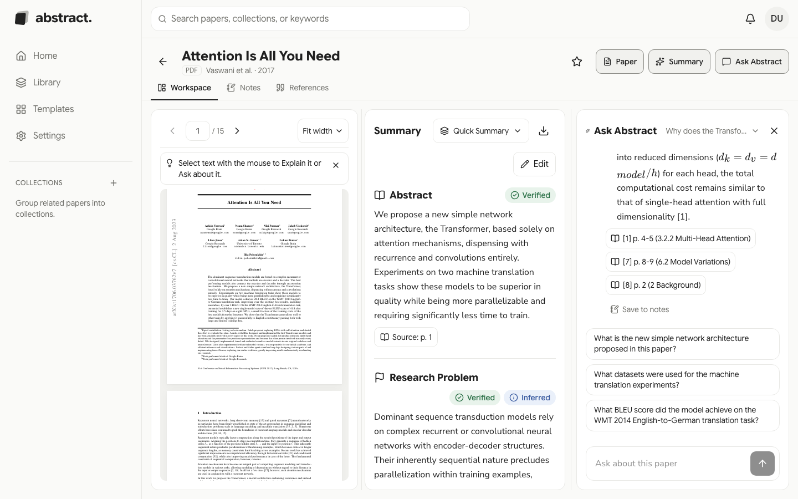</picture>

</div>

---

## Contents

- [What it does](#what-it-does)
- [Try it](#try-it)
- [Screenshots](#screenshots)
- [The brief, and how it is met](#the-brief-and-how-it-is-met)
- [Architecture](#architecture)
- [How the AI works](#how-the-ai-works)
- [Tech stack](#tech-stack)
- [Run it locally](#run-it-locally)
- [Configuration](#configuration)
- [Testing and quality](#testing-and-quality)
- [Deployment](#deployment)
- [Security and privacy](#security-and-privacy)
- [Project structure](#project-structure)
- [How it was built](#how-it-was-built)
- [Known limits and next steps](#known-limits-and-next-steps)

---

## What it does

Reading a paper well takes hours: finding the problem, the method, what was actually measured, and whether the conclusion follows. Abstract does the first pass in under a minute and shows its sources, so you can trust it and check it.

**Core**

- **Upload a PDF** (one at a time, up to 50 MB). The file goes straight from the browser to private storage, is checked and sanitized, and is processed in the background. Chat is ready within seconds.
- **Structured summary** from a template: *Quick Summary* (title and authors, abstract, problem, method, key results, conclusion) or *Detailed Research Analysis* (10 fields). It streams in field by field.
- **Every field is verified**: each quoted sentence is checked against the page it claims to come from. Fields show **Verified**, **Inferred** or **Not reported** instead of guessing, and every source chip opens the PDF at that sentence, highlighted.
- **Ask Abstract**: questions in plain language, answered only from the paper. Answers stream word by word with numbered citations; citations to passages that were not retrieved are rejected before you see them. Suggested questions are written for each paper.

**Beyond the brief**

- **Template builder**: design your own summary (up to 10 fields, each with an instruction and a type), drag to reorder, and try it on a paper before saving.
- **Reading aids**: select any passage to have it explained (plain or expert) or to ask about it.
- **Notes**: a notes page per paper, autosaved, and **Save to notes** on any answer keeps it with its sources.
- **References**: the paper's own reference list, matched on Semantic Scholar with authors, year, venue, citation count and open-access PDF links.
- **Library**: search across titles, authors and passages, collections, starring, grid or list.
- **Tables and figures** (on larger hosts): extracted with Docling, each with a caption and "Ask about this region".
- **Plans and limits** (Free, Pro, Internal) with daily AI spend caps, and an **Admin panel**: users, plans, model registry, feature flags, failed jobs and a usage dashboard with charts.
- **Works everywhere**: phones first, light and dark themes, keyboard accessible (WCAG 2.1 AA), checked in Chromium, Safari (WebKit) and Firefox.

---

## Try it

**Live:** https://abstract.oshadhakariyawasam.me

Sign up with Google or email, or use the shared demo account:

| | |
|---|---|
| Email | `demo.user+clerk_test@example.com` |
| Sign-in | **Use another method → Email code**, then `424242` |

The demo account already has *Attention Is All You Need*, *RAG*, *BERT* and *LoRA* processed. Sign-in currently runs on Clerk's development instance, so the form shows a small "Development mode" label.

---

## Screenshots

Screenshots follow your GitHub theme: switch GitHub to dark mode to see the app in dark.

**Home: drop a PDF to start**

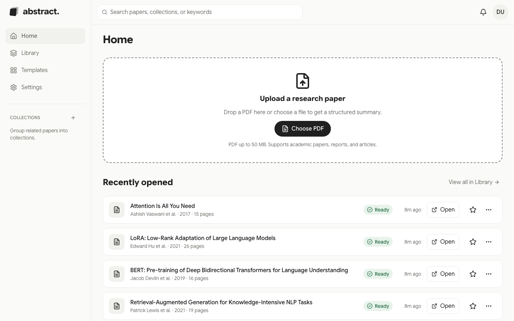

**Phone: Home, the summary, and a cited answer**

<p align="center">
  <picture><source media="(prefers-color-scheme: dark)" srcset="docs/images/phone-home-dark.png">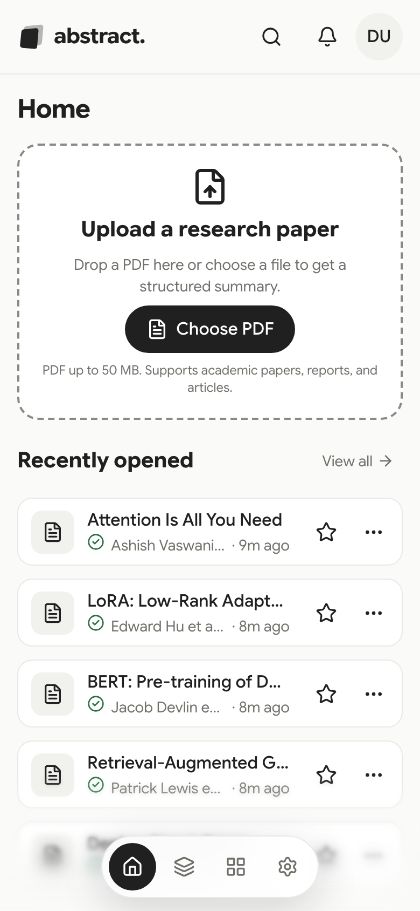</picture>
  &nbsp;
  <picture><source media="(prefers-color-scheme: dark)" srcset="docs/images/phone-summary-dark.png">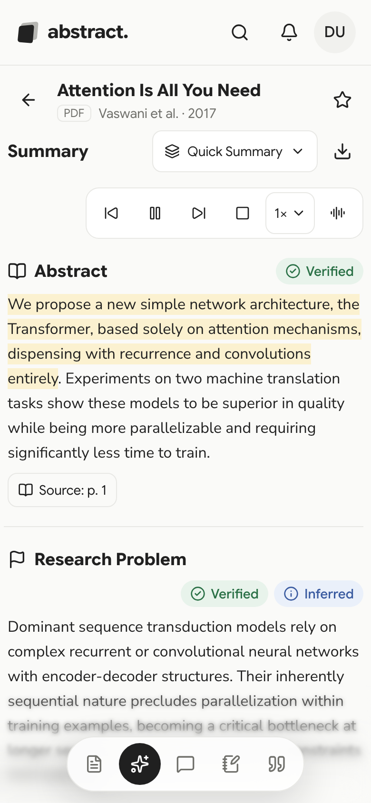</picture>
  &nbsp;
  <picture><source media="(prefers-color-scheme: dark)" srcset="docs/images/phone-chat-dark.png">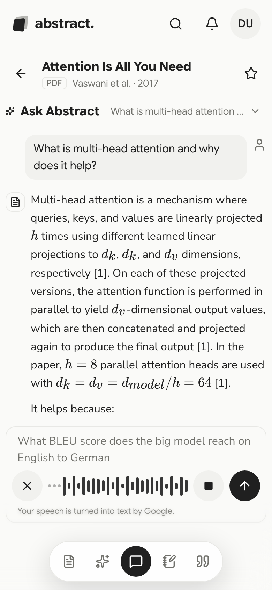</picture>
</p>

| Sign-in | Library |
|---|---|
| <picture><source media="(prefers-color-scheme: dark)" srcset="docs/images/sign-in-dark.png">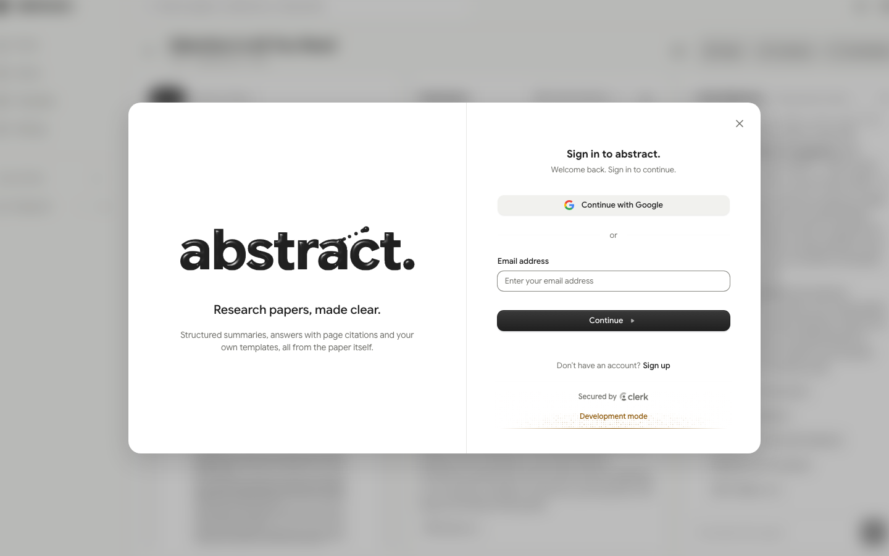</picture> | <picture><source media="(prefers-color-scheme: dark)" srcset="docs/images/library-dark.png">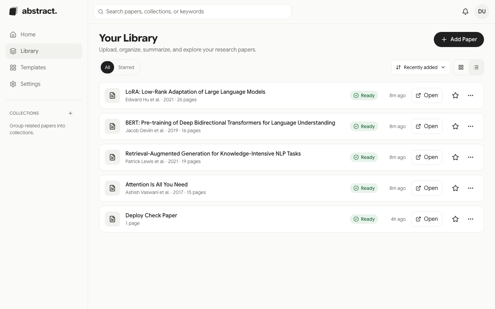</picture> |

<sub>Figures and tables are from a local run: the current production host has them switched off for memory (see [Known limits](#known-limits-and-next-steps)).</sub>

| Figures, extracted with captions | Tables, extracted as real tables |
|---|---|
| <picture><source media="(prefers-color-scheme: dark)" srcset="docs/images/figures-dark.png">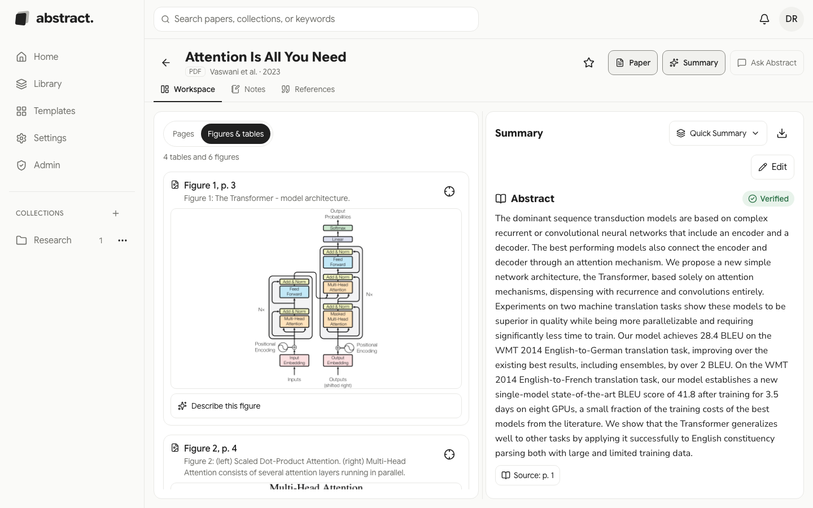</picture> | <picture><source media="(prefers-color-scheme: dark)" srcset="docs/images/tables-dark.png">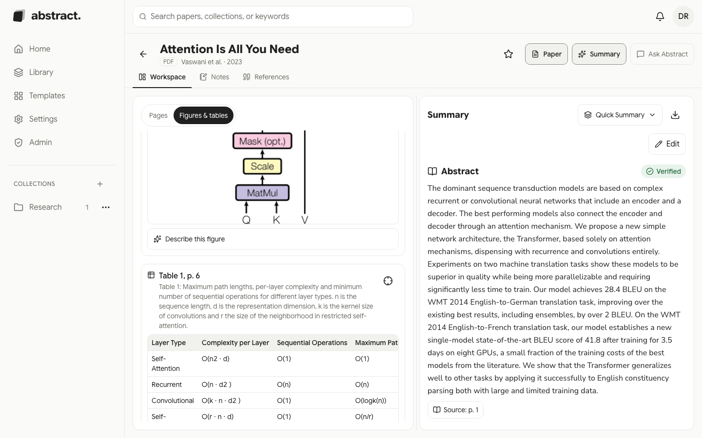</picture> |

| Templates | References, matched on Semantic Scholar |
|---|---|
| <picture><source media="(prefers-color-scheme: dark)" srcset="docs/images/templates-dark.png">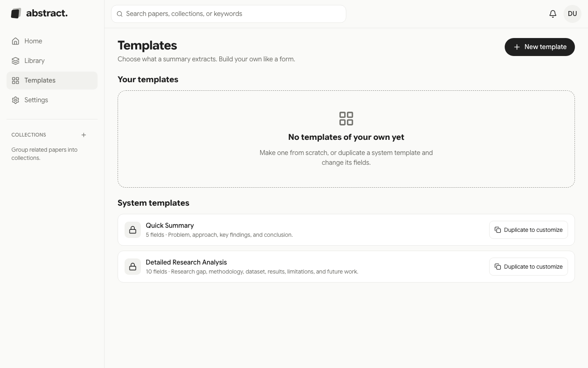</picture> | 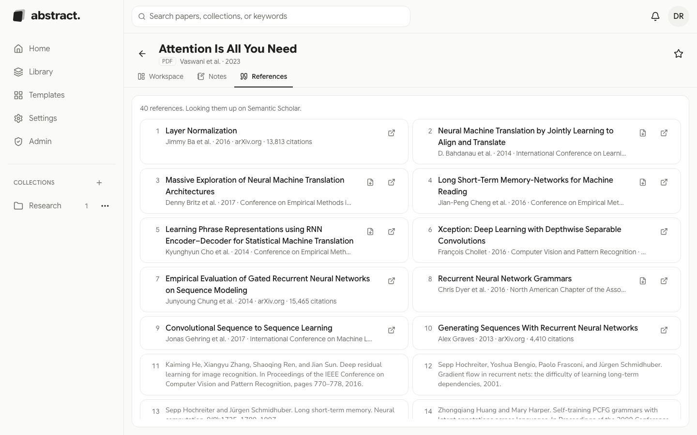 |

**Admin dashboard: usage, spend against the cap, jobs and plans**

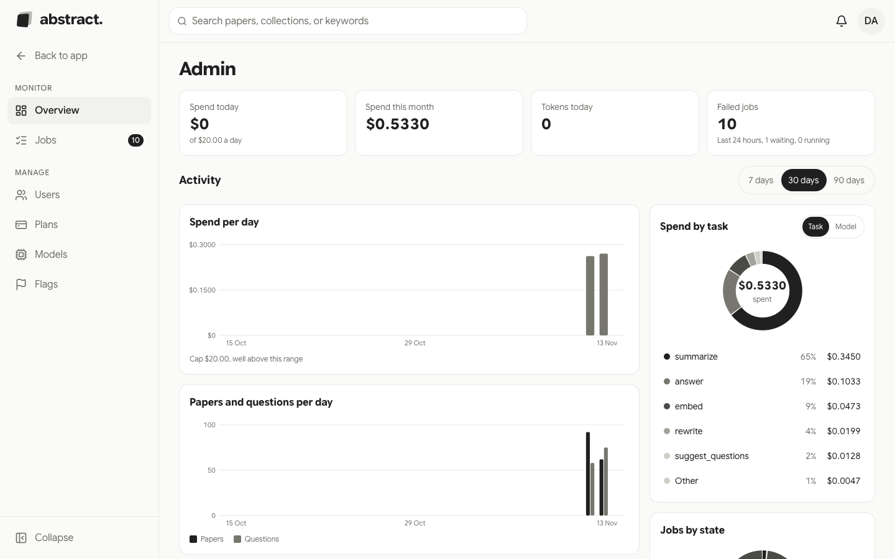

---

## The brief, and how it is met

From the client brief *"Use Case Document: Research Assistant for PDFs"* (the PDF stays out of git; transcribed in [`docs/requirements.md`](docs/requirements.md)).

| # | Requirement | How Abstract meets it |
|---|---|---|
| R1 | Full-stack app: upload papers, auto-generate a structured summary, LLM question answering | React web app, FastAPI API and Celery workers; summary and Ask Abstract on every paper |
| R2 | One paper at a time, PDF | Single upload with type, size, page and encryption checks, then sanitizing (active content removed) |
| R3 | Summary sections: Title & Authors and Abstract, Problem, Methodology, Key Results, Conclusion | The *Quick Summary* template is exactly these sections |
| R4 | Readable summary | Section cards, streamed, with Verified / Inferred / Not reported status and page sources |
| R5 | Natural-language questions, RAG welcome | Hybrid retrieval (vector + keyword), reranking, streamed answers with validated citations |
| R6 | React + Python | React 19 + Vite + TypeScript, Python 3.12 + FastAPI |
| R7 | AI assistance during development | Built with Claude Code under written rules ([`AGENTS.md`](AGENTS.md)), specs and a decision log; see [How it was built](#how-it-was-built) |
| R8 | Extra features | Template builder, reading aids, notes, references, library search and collections, tables and figures, plans, admin dashboard |
| R9 | Complete codebase on GitHub with commit history | This repository; Conventional Commits, one acceptance criterion per commit, merged by pull request |
| R10 | Setup instructions | [Run it locally](#run-it-locally): `cp .env.example .env && make dev` |

---

## Architecture

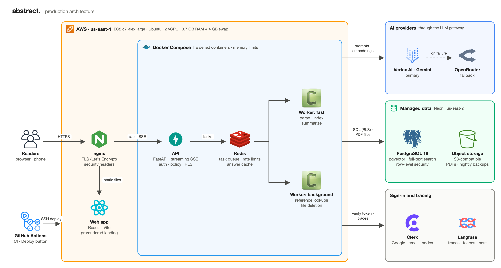

**How a request flows**

1. The browser loads the web app from **nginx** on the EC2 host (TLS by Let's Encrypt). The same origin serves the API under `/api`, so there is no cross-origin traffic.
2. The **API** (FastAPI) checks the Clerk token, applies the policy for that action and sets the tenant for Postgres **row-level security** before any query.
3. Uploads go **straight from the browser to object storage** with a short-lived presigned form; the API only records the job.
4. Long work is queued in **Redis** for **Celery** workers: the *fast* worker parses, indexes and summarizes; the *background* worker matches references and deletes files.
5. Every model call goes through the **LLM gateway**, which picks the model for the task from the **model registry**, falls back to OpenRouter if Vertex fails, enforces spend caps and logs tokens and cost (traced in Langfuse).
6. Summaries and answers stream back to the browser over **Server-Sent Events**.

The API, workers and Redis run with Docker Compose; the host keeps no user data (it lives in Neon Postgres and object storage), so the server can be rebuilt from the repo. Details: [`docs/architecture.md`](docs/architecture.md) and the production [runbook](docs/runbook.md).

---

## How the AI works

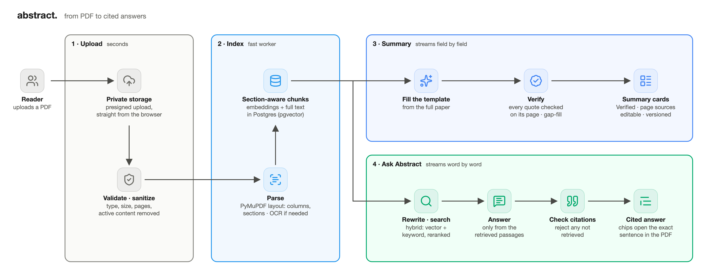

**1 · Upload.** Magic bytes, size (≤ 50 MB), page count and encryption are checked, then *pikepdf* writes a sanitized copy without JavaScript, launch actions or embedded files. Only the sanitized copy is ever processed or shown.

**2 · Index.** PyMuPDF reads the text with its layout: columns are detected per stripe, so two-column papers read in the right order; sections, pages and coordinates are kept; pages without text go to OCR. The text is cut into **section-aware chunks** (500 to 800 tokens with overlap and a header naming the paper and section), embedded, and stored with a full-text index in Postgres. References are kept out of retrieval.

**3 · Summary.** Papers that fit (most do) are summarized in **one streamed call over the whole text**, so nothing is missed between chunks. Each field comes back with its evidence quotes; every quote is **matched against its page** (fuzzy matching), unsupported fields are marked *Not reported* and get a second, targeted retrieval pass, and the result is saved as a version (your edits are never overwritten).

**4 · Ask Abstract.** The question is rewritten with the conversation's context and routed: questions about the whole paper use its full text or summary; specific ones use **hybrid search** (pgvector similarity + Postgres full text, fused with reciprocal rank fusion) and reranking down to 5 to 8 passages. The answer is generated only from those passages, and **every citation is validated**: a citation to anything not retrieved is removed. Each citation resolves to a page and the exact sentence to highlight.

### Where the AI runs

| | |
|---|---|
| Primary provider | **Google Vertex AI** (Gemini, `global` endpoint), called with a service account |
| Fallback | **OpenRouter** (Claude Haiku), used automatically when a Vertex call fails, with data collection denied |
| Gateway | Our own `LLMGateway` (no LangChain or LlamaIndex): one place for routing, retries, fallbacks, timeouts, spend caps and usage logging |
| Model choice | The **model registry** in Postgres maps each *task* to a model; admins can change it in the Admin panel without a deploy |
| Tests and CI | A deterministic **fake provider**: no test ever calls a paid model |
| Tracing | **Langfuse**: one trace per pipeline run, with tokens, cost and latency (metadata only, no paper text) |

Models in production today:

| Task | Model |
|---|---|
| Summaries, query rewrite, routing, suggested questions | `gemini-3.5-flash-lite` |
| Answers, region answers, figure descriptions | `gemini-3.6-flash` |
| Embeddings | `gemini-embedding-2` |
| Fallback for every generation task | `anthropic/claude-haiku-5.5` via OpenRouter |

**Guardrails.** Paper text is untrusted: it is never put in system prompts, it is wrapped in delimiters, and instructions found inside it are ignored. Template instructions are length-limited data. Each user has daily and monthly AI spend limits from their plan, the platform has a daily cap with an 80% warning, and admins have a kill switch for all paid calls.

---

## Tech stack

| Layer | Technology |
|---|---|
| Web | React 19, Vite, TypeScript (strict), TanStack Router and Query, Tailwind CSS v4, pdf.js, TipTap, KaTeX |
| API | Python 3.12, FastAPI, Pydantic v2, async SQLAlchemy 2.0, Alembic, structlog |
| Workers | Celery with Redis; PyMuPDF, pikepdf, Tesseract OCR; Docling for tables and figures |
| Data | PostgreSQL 18 with pgvector and full-text search, row-level security; S3-compatible object storage |
| AI | Vertex AI (Gemini), OpenRouter, own LLM gateway and model registry, Langfuse |
| Auth | Clerk (Google, email and password, email codes), roles and policy in our database |
| Infra | AWS EC2, Docker Compose, nginx, Let's Encrypt, Neon (Postgres and storage), GitHub Actions |
| Quality | pytest with real Postgres (testcontainers), Vitest and Testing Library, Playwright, axe, ruff, mypy `--strict`, ESLint |

---

## Run it locally

**You need** Docker (Desktop, or Engine with Compose v2) and `make`. To run things outside Docker you also need [uv](https://docs.astral.sh/uv/) (Python 3.12) and pnpm 10 with Node 22.

```bash
git clone https://github.com/Oxshadha/Abstract.git && cd Abstract
cp .env.example .env    # works as is: fake AI provider, local sign-in, no keys needed
make dev                # builds and starts web, api, workers, postgres, redis and s3
```

| Service | URL |
|---|---|
| Web app | http://localhost:5173 |
| API docs (OpenAPI) | http://localhost:8000/api/v1/docs |
| Health | http://localhost:8000/api/v1/readyz |

Open the web app and choose **Continue as demo user**. Upload any PDF: with the fake provider the summary and answers are placeholders, but every screen and step works. `make down` stops everything (data is kept); `make help` lists every command.

**With real models.** In `.env`, set `LLM_PROVIDER=vertex` with `GCP_SA_FILE` (path to a service-account JSON, mounted read-only and never committed) and `GCP_PROJECT_ID`, and `GCP_LOCATION=global`. Add `OPENROUTER_API_KEY` for the fallback, or use `LLM_PROVIDER=openrouter` on its own. Restart with `make dev`.

**With real sign-in.** Create a Clerk application, then set `VITE_CLERK_PUBLISHABLE_KEY` and `CLERK_ISSUER`. Make yourself an admin with `make account ID=user_... EMAIL=you@example.org ROLE=admin PLAN=internal`.

**Useful commands**

```bash
make install     # host dependencies (uv sync, pnpm install)
make hooks       # git hooks: lint on commit, Conventional Commit messages
make test        # backend (with real Postgres) and frontend tests, fake AI
make lint        # ruff, mypy --strict, eslint, tsc
make api-client  # regenerate the typed TypeScript client from the API schema
make dev-full    # like dev, plus real ClamAV virus scanning (about 3 GB more RAM)
```

---

## Configuration

All settings are environment variables, read from `.env` locally and from a root-only file on the server. The main ones:

| Variable | Purpose |
|---|---|
| `ENV` | `development`, `test` or `production` (production refuses unsafe settings, such as the fake provider or local sign-in) |
| `DATABASE_URL` / `MIGRATIONS_DATABASE_URL` | Runtime role (row-level security applies) / owner role for migrations |
| `REDIS_URL` | Queue, rate limits and answer cache |
| `S3_BUCKET`, `S3_ENDPOINT_URL`, `S3_REGION`, `S3_ACCESS_KEY_ID`, `S3_SECRET_ACCESS_KEY` | Object storage (AWS S3 or any S3-compatible service) |
| `LLM_PROVIDER` | `fake`, `vertex` or `openrouter` |
| `GCP_SA_FILE`, `GCP_PROJECT_ID`, `GCP_LOCATION` | Vertex AI service account and project |
| `OPENROUTER_API_KEY` | OpenRouter (fallback or primary) |
| `VITE_CLERK_PUBLISHABLE_KEY`, `CLERK_ISSUER`, `CLERK_AUTHORIZED_PARTIES` | Sign-in; empty means local development sign-in |
| `MALWARE_SCAN` | `fake`, `clamav`, `guardduty`, or `disabled-with-sanitization` in production |
| `ENRICHMENT_ENABLED` | Tables and figures (needs about 6 GB RAM for Docling) |
| `LANGFUSE_PUBLIC_KEY`, `LANGFUSE_SECRET_KEY` | Tracing; off when empty |
| `SENTRY_DSN`, `VITE_SENTRY_DSN` | Error reporting; off when empty |

See [`.env.example`](.env.example) for every variable with its default.

---

## Testing and quality

- **Every acceptance criterion has a test named after it** (`test_AC3_rejects_encrypted_pdf`), so a spec can be checked against the suite.
- **Backend:** 440 tests, including integration tests against a real PostgreSQL with pgvector (testcontainers), row-level security, the LLM gateway with recorded fixtures, and the full pipeline with the fake provider.
- **Web:** 237 tests (Vitest and Testing Library), with **axe** accessibility checks on every main screen, and a Playwright happy path across Chromium, WebKit and Firefox on desktop and phone sizes.
- **CI on every push:** commit message rules, ruff and mypy `--strict`, ESLint and `tsc`, all tests, the production build, an entry-bundle size budget (200 KB gzip), design-token drift, UI text rules, Docker image builds, a ClamAV test with the EICAR file, and a check that the generated API client is up to date.

---

## Deployment

Production runs on one AWS EC2 host shared with another app, with the database and files on Neon (decision [D100](docs/decisions.md)).

- **Deploy:** GitHub → Actions → **Deploy** → Run workflow. It only deploys a commit on `main` whose CI passed, builds the web app, sends it with the code over SSH with a deploy-only key, builds and migrates *before* switching, and **rolls back automatically** if the new version is not healthy within two minutes.
- **Migrations** are expand-only, so the previous version keeps working during a deploy.
- **Backups:** a nightly database dump goes to object storage and is kept 7 days; a restore drill restores it into a scratch database and compares row counts.
- **Containers** run with memory limits, no Linux capabilities and no privilege escalation; the PDF workers have read-only file systems.

Everything an operator needs (commands, rollback, restore, rebuilding the server) is in the [runbook](docs/runbook.md).

---

## Security and privacy

- **Tenancy:** every row has an `org_id`; every route calls `authorize(principal, action, resource)`; Postgres row-level security is the second line of defence. The app never connects as the table owner.
- **Untrusted input:** request schemas forbid unknown fields and bound every string and list; rate limits per user and route group; PDFs are sanitized before processing.
- **Secrets** are never in git or images: locally `.env` (ignored), in production a root-only file on the host and GitHub encrypted secrets.
- **Data:** no paper text is sent to tracing or error tools (metadata only). Deleting a paper deletes its summaries, chats, notes and files; backups expire after 7 days.
- **AI providers:** OpenRouter calls ask for no data collection; Vertex is called under our own Google Cloud project.

---

## Project structure

```
apps/
  web/                    React + Vite app
    src/features/<name>/  one folder per feature (chat, summaries, library, admin, ...)
    src/components/       shared UI (shell, dialogs, menus, status)
    e2e/                  Playwright happy path
  api/                    FastAPI app and Celery workers
    app/core/             config, database, auth, policy, rate limits, logging
    app/ports/            interfaces: parser, storage, LLM gateway, scanner, ...
    app/adapters/         implementations of the ports (PyMuPDF, S3, Vertex, OpenRouter, ...)
    app/modules/<name>/   one module per feature: router, service, schemas
    app/worker/           Celery tasks
    migrations/           Alembic migrations (expand-only)
design/tokens.json        design tokens, the single source of colours, fonts and spacing
eval/                     benchmark corpus, golden Q&A and harness (real models, run by hand)
infra/                    Docker Compose (local and production), nginx, deploy and backup scripts
docs/                     architecture, decisions, specs, runbook, diagrams
```

---

## How it was built

Abstract was built in four weeks by one developer working with **Claude Code** as an AI pair, under the same written rules a human contributor follows ([`AGENTS.md`](AGENTS.md)):

1. **Decide first.** Design questions were settled up front and recorded with their reasons: 101 numbered decisions in [`docs/decisions.md`](docs/decisions.md). Changing one needs a new entry, never a silent edit.
2. **Spec before code.** Each feature has a short spec with testable acceptance criteria, approved before any code: 19 specs in [`docs/specs/`](docs/specs/).
3. **Build in small steps.** One acceptance criterion per commit, with its test, every commit green, then a pull request per feature merged with its history kept (Conventional Commits).
4. **Check like a user.** UI changes are verified in Chromium, WebKit and Firefox at desktop and phone sizes, and the screenshots are looked at.
5. **Write it down.** Assumptions with their evidence, a development log, and a runbook for production.

| Document | What it holds |
|---|---|
| [`docs/requirements.md`](docs/requirements.md) | The brief's requirements, traced to specs |
| [`docs/architecture.md`](docs/architecture.md) | System design and roadmap |
| [`docs/decisions.md`](docs/decisions.md) | Every decision and why |
| [`docs/specs/`](docs/specs/) | Feature specs with acceptance criteria |
| [`docs/assumptions.md`](docs/assumptions.md) | Assumptions, checked external facts, risks |
| [`docs/runbook.md`](docs/runbook.md) | Operating production |
| [`docs/log.md`](docs/log.md) | Development log, newest first |

---

## Known limits and next steps

- **Tables and figures are off on the current host** (3.7 GB RAM; Docling needs about 6 GB). They return by moving to an 8 GB instance and setting `ENRICHMENT_ENABLED=true`.
- **Sign-in uses Clerk's development instance** for now; switching to production keys is configuration only.
- **Next:** a *Recently deleted* bin that keeps deleted papers for 7 days (spec 019), a content security policy, and the remaining production checks in spec 017.

<sub>Diagrams: `docs/diagrams/*.html`, rendered with `node docs/diagrams/render.mjs` (from `apps/web`). Icons from the `diagrams` project, Simple Icons and Lucide.</sub>
